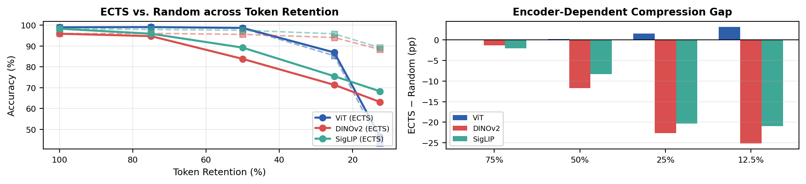
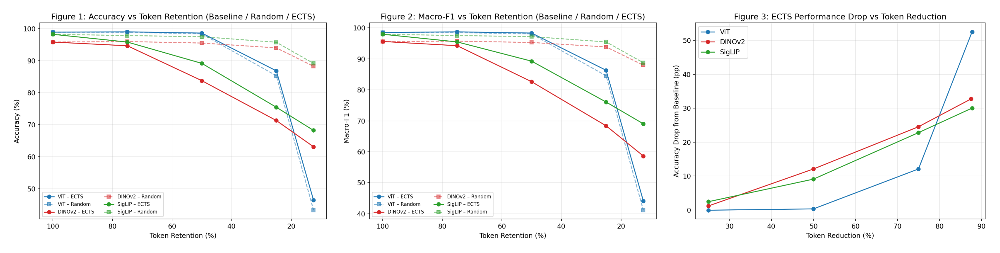
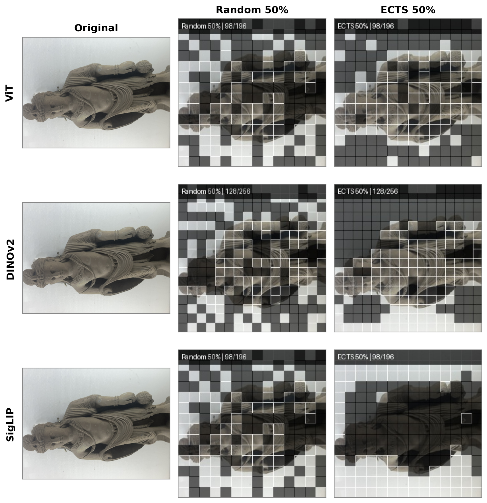

# Encoder-Dependent Visual Token Compression on the Taxila Museum Dataset (TAD-8K)

> **Does the same token-pruning method work across different vision encoders?**
> A controlled study of **ECTS (Early-Contextual Token Selection)** on ViT, DINOv2, SigLIP, and ConvNeXt-V2 for museum artifact recognition.


---

## TL;DR

- Token compression is usually evaluated on one encoder. We show that **its effectiveness depends heavily on the encoder**.
- ECTS preserves ViT performance at **50% token retention**, but it **underperforms random token removal on DINOv2 and SigLIP**.
- Compression is **not free**: at 50% retention, ECTS is **~3x slower** than the full-token baseline in real latency (sequential greedy selection overhead).
- A representation-drift diagnostic explains *why* it fails: DINOv2 and SigLIP embeddings drift far more, and far less consistently, once tokens are removed.



*Left: accuracy vs. token retention (solid = ECTS, dashed = random removal). Right: ECTS minus random accuracy in percentage points. ViT matches or beats random, while DINOv2 and SigLIP fall well below it.*

---

## Background

This work extends the Taxila Museum artifact recognition system from the **TIMA (Taxila Intelligent Museum Assistant)** final year project at the University of Haripur, which builds on:

> Khan et al., *"Using augmented reality and deep learning to enhance Taxila Museum experience,"* Journal of Real-Time Image Processing, Springer, 2021.

Instead of only recognizing artifacts, this repo asks a research question: **how much of the image can a vision encoder drop before it stops recognizing the artifact, and does the answer change with the encoder?**

---

## Dataset: TAD-8K

| Property | Value |
|---|---|
| Classes | 40 Taxila Museum artifact classes |
| Raw images | 8,068 |
| After exact-duplicate removal | 6,930 |
| Split (train / val / test) | 4,849 / 1,045 / 1,036 |
| Preprocessing | 224x224 |

**Cleaning pipeline**
1. Exact-duplicate removal (1,138 images removed).
2. pHash near-duplicate analysis, grouped into connected-component clusters and confidence tiers by pHash distance.
3. Conservative cluster reduction (keep several representatives, not one).
4. Artifact-level splits **before** any augmentation, so the same underlying photo never appears in both train and test.
5. Augmentation applied to the **training set only**.

> [!NOTE]
> **Dataset availability:** The images were collected and curated independently through on-site visits, where I photographed the Taxila Museum collection myself. This included selecting, cleaning and annotating/labelling etc the images. As no suitable public dataset was available, the dataset is not publicly released, but access can be requested by emailing abrarmoneeba@gmail.com.
---

## Method: ECTS (Early-Contextual Token Selection)

ECTS prunes visual tokens early in the encoder using a score that combines token relevance with a greedy, diversity-aware selection step, keeping a target fraction of tokens (e.g., 50%, 25%, 12.5%).

```
Input: patch tokens T, retention ratio r
1. Compute relevance score for each token
2. Greedily select tokens that are relevant AND diverse w.r.t. already-selected tokens
3. Keep the top r * |T| tokens and continue the forward pass
```

**Controls tried and rejected (kept as motivating evidence):**
- **Top-K magnitude selection**: worse than random at every retention level for all three encoders.
- **ECRAS** (magnitude + cosine-diversity redundancy scoring): also far worse than random (e.g., DINOv2 at 25% retention: 35.71% vs. 94.03% random).

---

## Results



*Figure 1: Accuracy vs. token retention (baseline / random / ECTS). Figure 2: Macro-F1 vs. token retention. Figure 3: ECTS accuracy drop from the full-token baseline as token reduction increases.*

### 1. Full-token baselines (test set)

| Encoder | Accuracy | Macro-F1 |
|---|---|---|
| ConvNeXt-V2 Base | **99.13%** | 98.77% |
| ViT-B/16 | 98.94% | TODO |
| SigLIP-B/16 | 98.26% | 97.95% |
| DINOv2-B/14 | 95.85% | 95.62% |

### 2. Selection-strategy ablation (50% retention, full 1,036-image test set)

| Encoder | Random baseline | Relevance + magnitude only | Diversity-aware greedy gain |
|---|---|---|---|
| ViT-B/16 | TODO | TODO | +5.02 pp |
| DINOv2-B/14 | 95.58% | 60.91% | +22.88 pp |
| SigLIP-B/16 | 97.55% | 57.82% | +31.37 pp |

Relevance + magnitude scoring alone is actively harmful for DINOv2 and SigLIP. Diversity-aware selection recovers a lot, but ECTS still underperforms random removal on these two encoders.

### 3. Representation drift (cosine similarity of pooled embedding, full vs. ECTS-50%, 300 test images)

| Encoder | Mean cosine sim | Std |
|---|---|---|
| ViT-B/16 | 0.969 | 0.026 |
| DINOv2-B/14 | 0.908 | 0.097 |
| SigLIP-B/16 | 0.888 | 0.173 |

ViT's embeddings stay stable under pruning. DINOv2 and SigLIP drift more and with much higher variance, which explains their failure even when the selected tokens look spatially reasonable.

### 4. Real inference latency (RTX 3050, batch size 1)

ECTS is **~3x slower** than the full-token baseline at 50% retention for all three encoders, because of sequential greedy selection. Only at **12.5% retention** does it give a net speedup (~1.1x).

### 5. Qualitative token selection

- **ViT:** selections are spatially tight and foreground-concentrated.
- **DINOv2:** selections look spatially similar to ViT's, despite much worse accuracy.
- **SigLIP:** selections are visibly less contiguous.



*Kept tokens (bright, outlined) vs. dropped tokens (darkened) at 50% retention. ViT and SigLIP keep 98 of 196 tokens, DINOv2 keeps 128 of 256.*

---

## Repository structure

```
.
├── data/                 # split files / dataset instructions (no raw images)
├── src/
│   ├── models/           # encoder wrappers (ViT, DINOv2, SigLIP, ConvNeXt-V2)
│   ├── compression/      # ECTS, random, Top-K, ECRAS
│   ├── train.py
│   ├── evaluate.py
│   ├── ablation.py
│   ├── latency.py
│   └── drift.py
├── configs/
├── results/              # tables, logs
├── figures/
├── paper/                # LaTeX source + .bib (added after approval)
├── requirements.txt
└── README.md
```

---

## Getting started

```bash
git clone https://github.com/aka-Trophy-Hunter/<repo-name>.git
cd <repo-name>
python -m venv venv && source venv/bin/activate
pip install -r requirements.txt
```

### Reproduce the experiments

```bash
# 1. Train / fine-tune an encoder
python src/train.py --encoder vit --config configs/vit.yaml

# 2. Evaluate with token compression
python src/evaluate.py --encoder vit --method ects --retention 0.5

# 3. Selection-strategy ablation
python src/ablation.py --encoder dinov2 --retention 0.5

# 4. Latency benchmark (batch size 1)
python src/latency.py --encoder siglip --retention 0.5

# 5. Representation drift diagnostic
python src/drift.py --encoder dinov2 --num-images 300
```

> `TODO: replace the commands above with your real script names and arguments.`

**Reproducibility:** seeds are fixed in `configs/`, dependencies are pinned in `requirements.txt`, and all reported numbers come from the 1,036-image test set unless stated otherwise. Latency numbers were measured on an NVIDIA RTX 3050 and will vary by hardware.

---

## Key takeaways

1. **Token selection is not encoder-agnostic.** A method that works for ViT can be worse than random for DINOv2 or SigLIP.
2. **Good-looking selections can still fail.** Spatially plausible token choices do not guarantee a stable representation.
3. **Diversity matters.** Relevance-only scoring is harmful, and diversity-aware selection recovers much of the loss.
4. **Compression has a cost.** Selection overhead can cancel out the savings unless retention is aggressive.

---

## Limitations

- Single dataset (40-class museum artifact recognition), so conclusions may not transfer to other domains or to full vision-language models.
- Latency was measured on one consumer GPU at batch size 1.
---

## Future work

- Test encoder-aware compression inside full VLMs.
- Reduce ECTS selection overhead (parallel or approximate selection).
- Study efficient token compression for onboard processings.

---

## Citation

The paper is in preparation. A preprint link will be added here.

```bibtex
@misc{abrar2026ects,
  title  = {TODO: final paper title},
  author = {Abrar, Moneeba and TODO: co-authors},
  year   = {2026},
  note   = {Manuscript in preparation}
}
```

---

## Acknowledgements

- Base work: Khan et al., 2021 (Taxila Museum AR / deep learning)

## Contact

**Moneeba Abrar** · GitHub: [@aka-Trophy-Hunter](https://github.com/aka-Trophy-Hunter) · Email: abrarmoneeba@gmail.com
